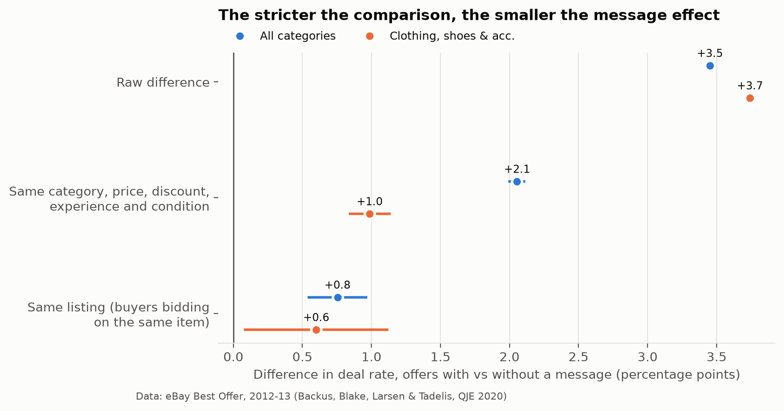

# Marketplace negotiation analysis: eBay Best Offer

Where do buyer–seller negotiations on a second-hand marketplace turn into sales, and where are they lost? This
project analyses **28 million negotiations** (47 million offers) from eBay's public Best Offer data and turns the
findings into experiment designs a negotiation product team could run.

**Read the two-page write-up: [reports/REPORT.md](reports/REPORT.md)**

## Findings

| Question | Answer |
|---|---|
| Do offers sent with a message close more often? | +3.5 points in the raw data, but only **+0.8** when comparing buyers on the same listing (clothing: +3.7 → +0.6). The dashboard overstates the gain about fourfold. |
| Where are most deals lost? | **43% of seller counteroffers are never answered** by the buyer. |
| What about seller automation? | 19% of opening offers are auto-declined. Even within 10% of the hidden floor, 30% of buyers never try again. |
| Does speed matter? | Deals follow 31.5% of counteroffers sent within an hour vs 24.3% after a day (association). |
| Why measure the seller side? | On 47% of negotiations, other buyers compete for the same listing, so buyer-randomised tests can count a moved sale as a new one. |



## Method

- **Unit:** one negotiation = one buyer × one listing. Thread ids are reused across items in the anonymised release, so
  they are not used as the unit.
- **Three comparisons, each stricter:** raw; matched cells (category × list price × opening discount × buyer and seller
  experience × condition, weighted to message senders); listing fixed effects with seller-clustered errors.
- **Data check:** countered offers carry a 48-hour placeholder reply time in the release; reply time is rebuilt from
  the counteroffer's arrival (covered by a test).
- **Experiment design:** primary metric, guardrails, randomisation unit and sample size from the measured baselines
  ([scripts/06_experiment_design.py](scripts/06_experiment_design.py)).

## Reproduce

The data are public but not redistributed here. Download from NBER
([nber.org/research/data/best-offer-sequential-bargaining](https://www.nber.org/research/data/best-offer-sequential-bargaining)) into `data/raw/`:
`anon_bo_threads.csv.gz`, `anon_bo_lists.csv.gz`, `Codebook.xlsx` (about 6 GB in total).

```bash
python -m venv .venv && .venv/bin/pip install -r requirements.txt
.venv/bin/python -I scripts/01_threads_to_parquet.py data/raw/anon_bo_threads.csv.gz data/processed/threads.parquet
.venv/bin/python -I scripts/03_lists_to_parquet.py data/raw/anon_bo_lists.csv.gz data/processed/threads.parquet data/processed/lists_bo.parquet
.venv/bin/python -I scripts/04_build_negotiations.py   # ~30 min on an 8 GB laptop
SMOKE=1 .venv/bin/python -I scripts/05_analysis.py     # 1% sample, ~1 min code check
.venv/bin/python -I scripts/05_analysis.py             # full run -> reports/tables/
.venv/bin/python -I scripts/06_experiment_design.py
.venv/bin/python -I scripts/07_figures.py
.venv/bin/python -m pytest -q tests
```

DuckDB does the heavy lifting out of core, so the full pipeline runs on a laptop.

| Folder | Contents |
|---|---|
| `src/` | Negotiation-table definition (SQL) |
| `scripts/` | Pipeline steps 01–07 |
| `tests/` | Toy-data tests of the negotiation definitions |
| `reports/` | Write-up and result tables (CSV) |
| `figures/` | Charts used in the write-up |

## Data and citation

Data: Backus, M., Blake, T., Larsen, B., & Tadelis, S. (2020). Sequential Bargaining in the Field: Evidence from
Millions of Online Bargaining Interactions. *The Quarterly Journal of Economics*, 135(3), 1319–1361.
https://doi.org/10.1093/qje/qjaa003

All analysis, code and interpretation here are my own and are not endorsed by the authors or by eBay. Results describe
eBay in 2012–13 and are associations, not causal estimates.

Author: Nathan Chen · [github.com/nathanchc](https://github.com/nathanchc)
