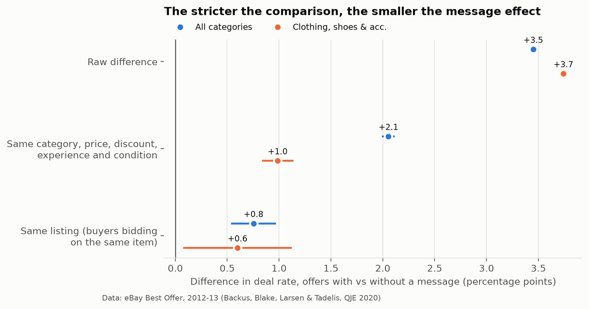
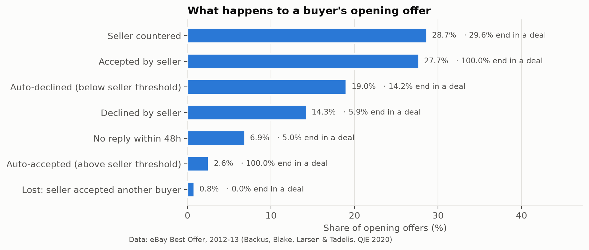
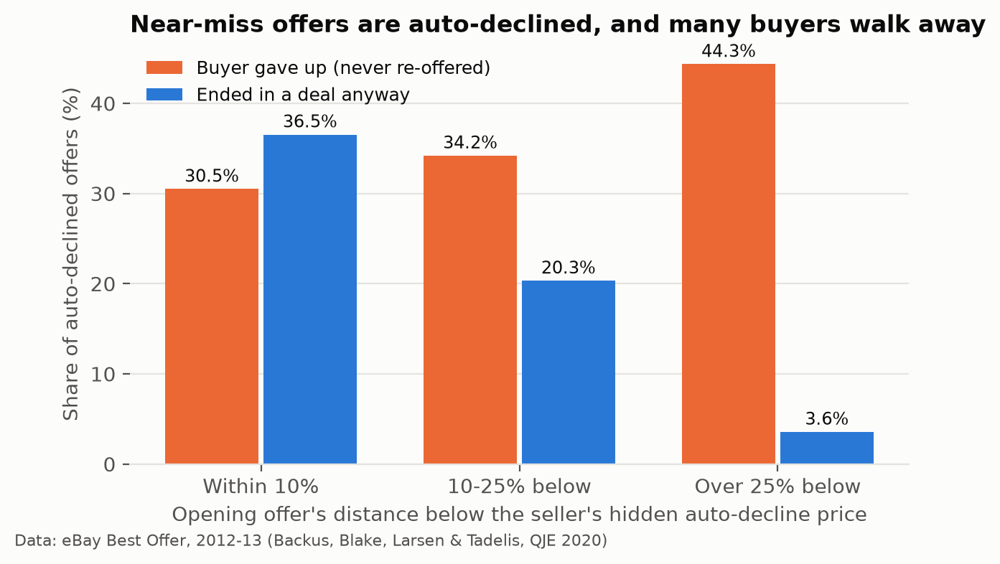
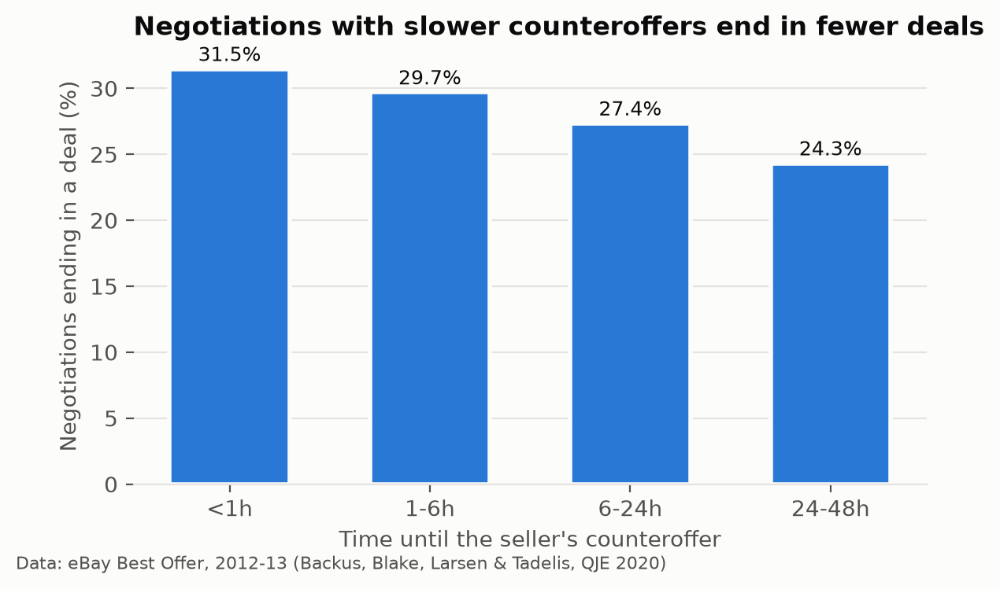

# Where marketplace negotiations are won and lost

**Evidence from 28 million eBay Best Offer negotiations, and the experiments it points to**
Nathan Chen · Data: eBay Best Offer, June 2012 to June 2013 (Backus, Blake, Larsen & Tadelis, *QJE* 2020)

---

## Summary

A negotiation team usually starts from a dashboard pattern: offers sent with a message close more often. In this data
they do, by 3.5 percentage points. Most of that gap disappears once like is compared with like. Comparing buyers
negotiating over **the same listing**, the gap falls to **0.8 points** (0.6 in clothing). A message prompt might still
help, but the dashboard overstates the gain by about four times. It should be tested, not shipped.

The larger losses sit elsewhere:

- **43% of seller counteroffers are never answered by the buyer.** That is 3.4 million negotiations left open, the
  biggest single place where deals are lost.
- **Near-miss offers are auto-declined.** Opening offers within 10% of the seller's hidden auto-decline price end in a
  sale 37% of the time, but 30% of those buyers never offer again.
- **Counteroffer speed** goes with the outcome: 31.5% of negotiations end in a deal when the seller counters within an
  hour, 24.3% when the counter comes after a day.

Each of these points to a product change that can be tested, and each needs seller-side guardrails, because on
**47% of negotiations** other buyers are bidding on the same listing.

## 1. The data and the measures

The data cover 47 million offers on 19.5 million fixed-price listings that received at least one Best Offer. The unit
is one **negotiation**: one buyer bargaining over one listing, up to three opening offers and the counteroffers that
follow. That gives 28.1 million negotiations, 5.7 million of them in Clothing, Shoes & Accessories, the category closest
to Vinted's core.

| Measure | All categories | Clothing |
|---|---|---|
| Negotiations ending in a deal | 42.7% | 46.4% |
| Median opening offer, % of list price | 62.6% | 62.5% |
| Median deal price, % of list price | 75.0% | 75.0% |
| Offers per negotiation | 1.68 | 1.67 |
| Negotiations with a seller counteroffer | 30.9% | 29.3% |
| Negotiations ending with an unanswered offer | 20.4% | 19.1% |
| Median time to a manual seller reply | 1.5 h | 1.2 h |
| Opening offers handled by seller automation | 21.6% | 23.1% |
| Opening offers sent with a message | 7.4% | 6.3% |

**A data note.** For countered offers the release records the reply time as a 48-hour placeholder. Reply times here use
the arrival of the seller's counteroffer instead (median 1.6 h). Without this fix, countering sellers would look like
they take two days to answer.

## 2. Do messages close deals?

| Comparison | All categories | Clothing |
|---|---|---|
| Raw difference in deal rate | +3.5 pts | +3.7 pts |
| Same category, list price, opening discount, buyer and seller experience, condition | +2.1 pts | +1.0 pts |
| Same listing, controlling for opening discount, buyer experience, arrival order | **+0.8 pts** (SE 0.1) | **+0.6 pts** (SE 0.3) |

Buyers who write messages are different buyers. Their opening offers are higher (median 66.7% of the list price vs
62.5%), and they write on different listings. The matched comparison removes those differences across 45,000 cells,
weighted to message senders. The same-listing comparison uses only listings where some buyers wrote and others did not.
It removes everything about the item and the seller, at the cost of covering only listings with competing buyers.

Messages do not come with a worse price for the seller: matched deal prices differ by 0.1% of the list price.

**What this does not show.** Even the same-listing estimate is not causal, because the buyers who write may be more
committed in ways the data do not record. The defensible conclusion is that **the effect is at most about one point, and
possibly zero**. That is the input an experiment needs for its sample size.

## 3. Where negotiations are lost

**Counteroffers left unanswered.** Sellers counter 28.7% of opening offers. After a counter, 29.6% of negotiations end
in a deal, 24.2% are declined, and **42.6% end because the buyer never responds**.

**Hidden thresholds.** 19% of opening offers are auto-declined by the seller's private floor. The closer the offer was,
the more often the buyer tries again. Yet even within 10% of the floor, 30.5% walk away. Those are deals both sides
were close to.

**Speed.** Faster counteroffers go with more deals: 31.5% under 1 hour, 24.3% at 24 to 48 hours. Sellers who answer fast
may differ in other ways, so this shows where to look, not what speed is worth.

## 4. The seller side and buyer competition

On **47% of negotiations**, other buyers are negotiating over the same listing, and 2.0% of negotiations end because the
seller accepted someone else. So a buyer-side change can move a sale from one buyer to another without creating a new
one. A buyer-randomised test would count that as a win. Seller outcomes, such as whether the listing sells, at what
price, and the seller's message load, have to be measured alongside, which is the problem Vinted's 2024 paper on
seller-side outcomes in buyer-side experiments addresses (Pilkauskaitė, Gamper, Giniūnaitė & Reklaitė, arXiv 2409.04174).

## 5. The experiments I would run

| | A. Counter-offer reminder | B. Near-miss hint | C. Message prompt |
|---|---|---|---|
| Change | Remind the buyer before a seller's counteroffer expires | Tell the buyer an auto-declined offer was close | Suggest adding a short message to the offer |
| Primary metric | Negotiations ending in a deal | Same | Same |
| Guardrails | Deal price % of list, buyer opt-outs | Deal price % of list (sellers may sell for less), seller opt-outs of auto-decline | Seller reply rate, seller messages handled |
| Unit | Buyer | Listing (all buyers on it share the arm) | Listing |

**Sample size.** On the clothing baseline (46.4%), detecting a 1-point lift with 80% power at the 5% level needs about
**39,000 negotiations per arm**; a 0.5-point lift needs about 156,000. Randomising by listing raises this by about 14%,
assuming a within-listing correlation of 0.1 and 2.4 buyers per listing (averaged over negotiations). That correlation is
an assumption to check in an A/A test.

**Before the readout**, the plan fixes the metrics, a sample-ratio check, CUPED on each buyer's previous deal rate, and
the decision rule: launch only if the primary lift's interval excludes zero and deal prices fall by less than half a
point.

## Limits

- This is eBay in 2012–13, mostly US. Vinted's buyers, fees and interface differ, so the numbers are an outside
  reference point, not an estimate for Vinted.
- Every result above is an association. Section 5 is how to turn them into causal answers.
- The standard errors in the matched comparison do not account for repeat sellers and are too small. Those in the
  same-listing comparison are clustered by seller.

*Code, tests and tables: see the [README](../README.md). The data are public from NBER and are not redistributed here.*
